# Informe final — Laboratorio 3: Prueba de concepto e infraestructura como código

**Curso:** Arquitectura Cloud · Universidad Adolfo Ibáñez
**Grupo VPM:** Vicente Vásquez · Matías Medina · Pascal Jorquera
**Profesor:** Nicolás Riderelli
**Fecha:** 24 de noviembre de 2026

**URL de ejemplo:** https://web-636986210007.southamerica-west1.run.app (apagada el 25-11-2026, tras la presentación, para no seguir consumiendo créditos)
**Repositorio:** https://github.com/Matikd9/Proyecto-PDI

> Trabajo académico. La plataforma **no es un servicio oficial** de la Policía de Investigaciones de Chile (PDI),
> usa solo datos ficticios y se presenta con la marca ficticia "DPI". Las integraciones institucionales
> (ClaveÚnica, Registro Civil, Migraciones, Interpol) están **simuladas**.

---

## Resumen

En los laboratorios 1 y 2 diseñamos una plataforma en Google Cloud para digitalizar la solicitud, validación y
emisión de dos certificados migratorios: el **Certificado de Viajes** y el **Certificado de Vigencia de
Permanencia Definitiva**. En este laboratorio construimos una prueba de concepto funcional de esa arquitectura y
la desplegamos en la región de Santiago (`southamerica-west1`), con toda la infraestructura definida en
**Terraform**.

La prueba de concepto cubre el flujo completo: un ciudadano se registra, completa el formulario, adjunta su
documento de identidad y envía la solicitud. El sistema la valida automáticamente contra servicios externos
simulados y contra una lectura real del documento con **Gemini**. Un funcionario la revisa y emite el
certificado en PDF, que cualquier persona puede verificar con un código público. Cada cambio de estado genera
un evento en **Pub/Sub**, que dispara una notificación simulada.

Como evidencia de reproducibilidad, **destruimos toda la infraestructura y la recreamos desde cero** siguiendo
solo la documentación. El flujo completo volvió a funcionar en la URL pública.

---

## 1. Objetivo del laboratorio

El enunciado pide una prueba de concepto a nivel de código y el uso de infraestructura como código (IaC), para
eliminar el factor humano en la creación de la infraestructura. Los entregables son:

| Entregable | Dónde está |
|---|---|
| Archivos de ejecución | `infra/` (Terraform), `scripts/deploy.ps1`, `cloudbuild.yaml`, `docker-compose.yml`, código en `app/` |
| Documentación paso a paso para replicar la infraestructura | [`docs/03-despliegue.md`](03-despliegue.md) |
| URL de ejemplo | https://web-636986210007.southamerica-west1.run.app (apagada el 25-11-2026, tras la presentación, para no seguir consumiendo créditos); se recrea con `docs/03-despliegue.md` |
| Documentación para ejecutar la prueba de concepto | [`README.md`](../README.md) y este informe |

## 2. Problema y solución propuesta

Hoy estos certificados dependen de atención presencial y de correo electrónico. Eso implica poca trazabilidad,
sobrecarga administrativa y dificultad para validar la información de los solicitantes (Lab 1).

La solución es un portal web donde el ciudadano ingresa su solicitud y adjunta documentos. Un backend valida la
información de forma automática y un backoffice permite a los funcionarios revisar, pedir correcciones, rechazar
o emitir. Se mantiene una regla de negocio central del Lab 1: **el sistema nunca rechaza automáticamente**.
Cualquier alerta deriva a revisión humana, sin revelarle al ciudadano el motivo.

## 3. Alcance: qué se implementó del diseño del Lab 2

El Lab 2 definió una arquitectura de referencia por capas. La prueba de concepto implementa el núcleo de cada
capa con un alcance acorde a un laboratorio y a un presupuesto de ≈ USD 150 en créditos.

| Capa (Lab 2) | Componente del diseño | En la prueba de concepto |
|---|---|---|
| **Acceso e identidad** | Identity Platform | ✅ Implementado: registro e inicio de sesión con correo y contraseña |
| | ClaveÚnica (OIDC) | 🟡 Simulado: botón con el formato oficial, deshabilitado (D-14) |
| | Cloud Load Balancing + Cloud Armor | ⚪ No desplegado: costo fijo ≈ USD 26/mes; evaluado y descartado en T10 |
| | Identity-Aware Proxy para funcionarios | ⚪ No aplica: el backoffice usa la misma API; la separación se hace con roles en la base (D-04) |
| **Negocio** | Portal web y backoffice en Cloud Run | ✅ Implementado: servicio `web` (React + nginx) con vistas por rol |
| | API de trámites en Cloud Run | ✅ Implementado: servicio `api` (FastAPI) |
| | Notificaciones con funciones | ✅ Implementado: servicio `notificaciones` en Cloud Run, invocado por Pub/Sub; el correo es simulado |
| | Cloud Workflows | ⚪ Reemplazado: la orquestación de la validación vive en la API (D-07) |
| **Inteligencia artificial** | Gemini para lectura de documentos | ✅ Implementado: Gemini 3.1 Flash-Lite en Vertex AI (D-13) |
| | Verificación facial, BigQuery ML, MLOps | ⚪ Fuera de alcance |
| **Datos** | Cloud SQL PostgreSQL | ✅ Implementado: PostgreSQL 16, solo IP privada, TLS obligatorio |
| | Cloud Storage para documentos | ✅ Implementado: bucket privado, acceso solo a través de la API |
| | Pub/Sub como bus de eventos | ✅ Implementado: tema `solicitud-eventos` con suscripción push autenticada |
| | Cloud Logging para auditoría | ✅ Implementado: logs JSON y tabla de auditoría en la base |
| | BigQuery como data warehouse | ⚪ Fuera de alcance |
| **Integración** | Adaptadores a sistemas externos | 🟡 Simulados con reglas deterministas sobre datos ficticios (D-07) |
| | Cloud VPN HA y Cloud NAT | ⚪ No necesarios: no hay sistemas externos reales a los que conectarse |
| **Ambientes** | DEV, QA y PROD | 🟡 Solo DEV; el código es parametrizable por `.tfvars` (D-01) |

✅ implementado · 🟡 simulado o parcial · ⚪ fuera de alcance, con su justificación

## 4. Arquitectura desplegada

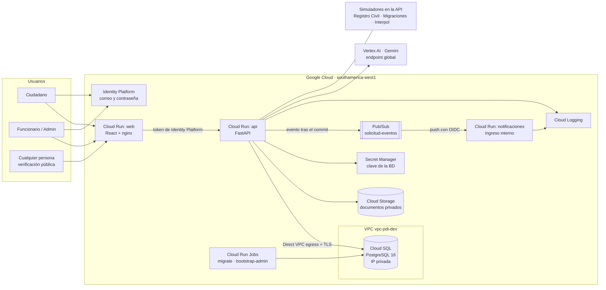

**Flujo de una solicitud:**

1. El ciudadano inicia sesión. Identity Platform emite un token que la API verifica en cada petición; el rol se
   lee de la tabla `usuarios`, nunca del token.
2. Completa el formulario y sube su documento. La API valida tipo (por firma binaria) y tamaño, y lo guarda en
   el bucket con un nombre no predecible (`solicitudes/{uuid}/{uuid}`).
3. Al enviar, la API ejecuta la validación automática: documentos obligatorios, duplicados, Registro Civil,
   Migraciones e Interpol (simulados) y lectura del documento con Gemini.
4. Según el resultado, la solicitud queda en revisión del funcionario (con o sin alerta) u observada, con el
   motivo visible si el ciudadano debe corregir algo.
5. Cada cambio de estado se registra en el historial y se publica en Pub/Sub. El servicio `notificaciones`
   recibe el evento y registra el correo simulado en Cloud Logging.
6. El funcionario revisa los resultados de validación y el documento, y emite el certificado. El PDF se genera
   al vuelo con un código de verificación de 12 caracteres, que se comprueba públicamente en `/verificar`.

**Estados:** `BORRADOR → RECIBIDA → EN_VALIDACION → {PREAPROBADA | EN_REVISION | OBSERVADA}` y, por decisión
del funcionario, `EMITIDA`, `OBSERVADA` o `RECHAZADA`. `PREAPROBADA` se muestra al ciudadano como "En revisión",
para que no pueda deducir si hubo una alerta.

## 5. Seguridad

| Aspecto | Cómo se resolvió |
|---|---|
| Roles privilegiados | Viven en la base de datos. Todo usuario nuevo es `ciudadano`. El primer administrador se crea con un Cloud Run Job protegido por IAM y los siguientes solo desde el panel de administración (D-04) |
| Separación de funciones | El administrador no gestiona solicitudes y el funcionario no administra usuarios |
| Recursos ajenos | Responden 404 en vez de 403, para no revelar su existencia; los identificadores son UUID (D-05) |
| Entradas | Los esquemas rechazan campos inesperados (`rol`, `estado`) con 422; transiciones de estado validadas en el servidor |
| Documentos | Bucket privado con prevención de acceso público, sin URLs firmadas, descargas de funcionarios auditadas (D-06) |
| Base de datos | Sin IP pública, conexión por red privada y TLS obligatorio; clave aleatoria en Secret Manager |
| Cuentas de servicio | Una por servicio, con roles sobre el recurso concreto siempre que GCP lo permite |
| Notificaciones | Ingreso interno: desde internet responde 404; solo Pub/Sub puede invocarlo, con token OIDC |
| Modo de desarrollo | La API se niega a arrancar con autenticación de desarrollo dentro de Cloud Run (D-10) |
| Gemini | Solo devuelve campos estructurados; la comparación la hace el código y un resultado positivo no omite ninguna otra regla (D-13) |

## 6. Infraestructura como código

Toda la infraestructura está en Terraform, dividida en dos partes:

- **`infra/bootstrap`** (estado local): bucket del estado de Terraform, bucket de código fuente para Cloud Build,
  Artifact Registry y la cuenta de servicio de compilación. Se aplica una sola vez por proyecto.
- **`infra/main`** (estado remoto en GCS): red, Cloud SQL, Secret Manager, bucket de documentos, Pub/Sub, Cloud
  Run (servicios y jobs), Identity Platform, API key y cuentas de servicio. Son **46 recursos**.

El script [`scripts/deploy.ps1`](../scripts/deploy.ps1) despliega una versión nueva con un solo comando:
compila las tres imágenes con Cloud Build (etiquetadas con el SHA de git), aplica Terraform y ejecuta la
migración de la base como Cloud Run Job.

**Prueba de reproducibilidad (T11).** Destruimos `infra/main` por completo y lo recreamos siguiendo solo
[`docs/03-despliegue.md`](03-despliegue.md). Aparecieron tres obstáculos propios de GCP, que quedaron resueltos
en el código y documentados (D-12):

| Obstáculo | Solución |
|---|---|
| GCP reserva por días el nombre de una instancia de Cloud SQL y de una API key borradas | Sufijo aleatorio en ambos nombres |
| Identity Platform no se puede desactivar: el siguiente `apply` fallaba | Bloque `import` que adopta la configuración existente |
| La subred de Cloud Run tarda en liberarse (≈ 1 h 30 min en nuestra prueba) | Documentado: basta con reintentar `destroy`; lo que tiene costo se borra en el primer intento |

Tras la recreación, el flujo completo volvió a funcionar y `terraform plan` respondió "No changes".

## 7. Recorrido de la prueba de concepto

Capturas tomadas en el entorno local, que usa el mismo código que el desplegado. En local la autenticación
usa el modo de desarrollo, por eso la pantalla de ingreso no pide contraseña.

| | |
|---|---|
| 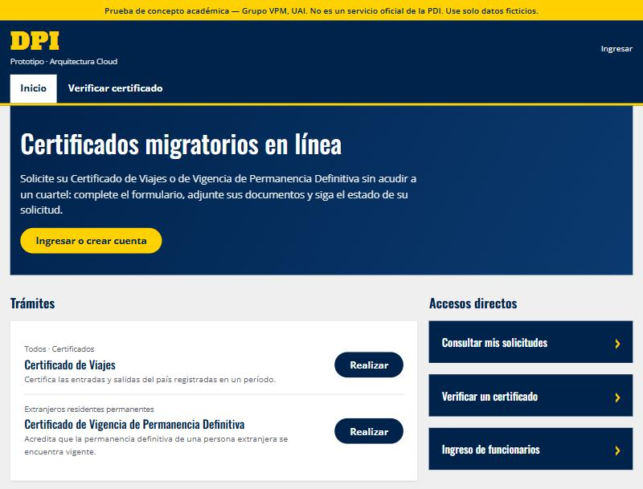 **Inicio:** trámites disponibles y accesos directos. | 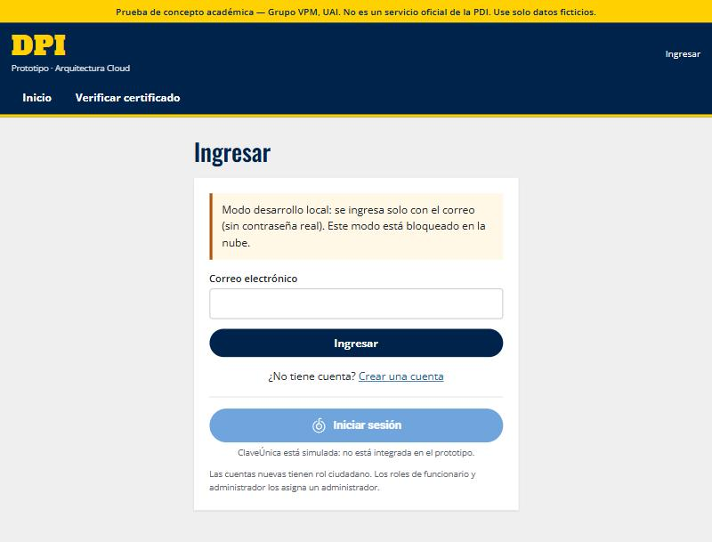 **Ingreso:** cuenta propia; ClaveÚnica aparece simulada. |
| 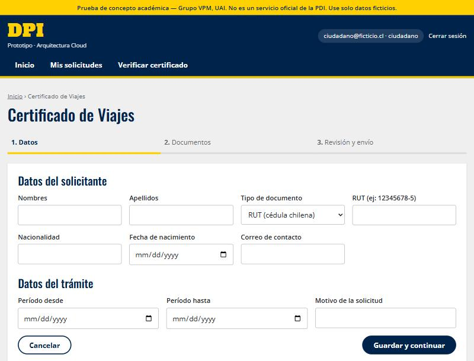 **Formulario** en tres pasos: datos, documentos, revisión y envío. | 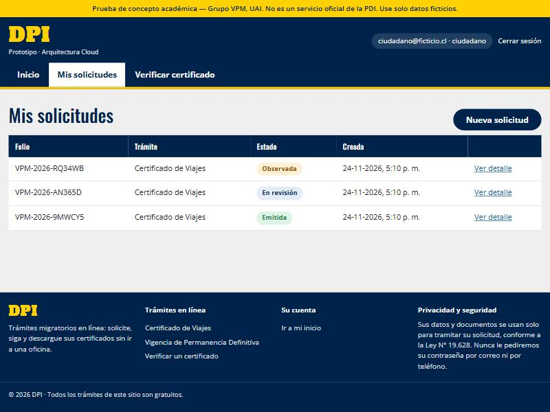 **Mis solicitudes:** el ciudadano ve el estado público de cada una. |
| 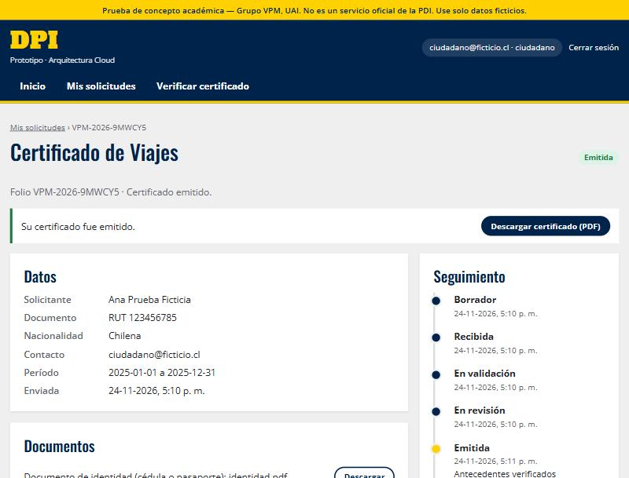 **Detalle:** seguimiento y descarga del certificado emitido. | 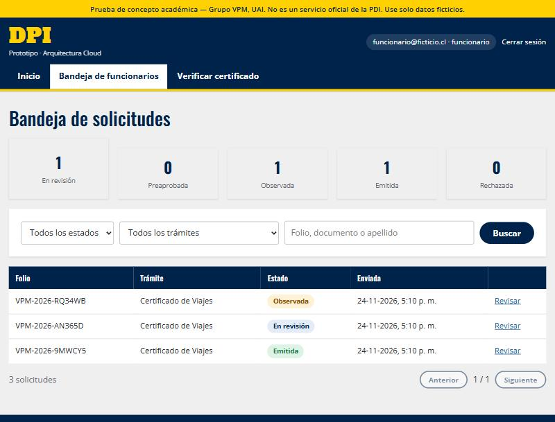 **Bandeja del funcionario** con resumen por estado y filtros. |
| 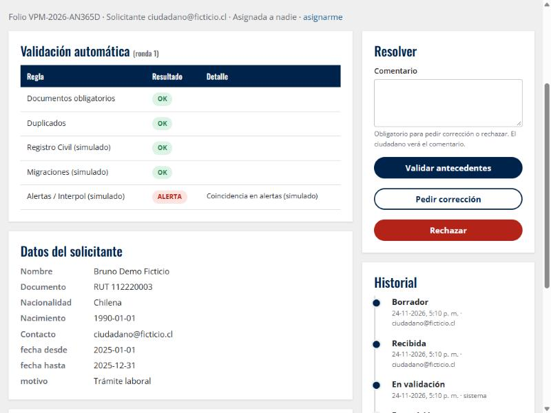 **Revisión:** resultados de la validación automática (aquí, alerta simulada de Interpol). | 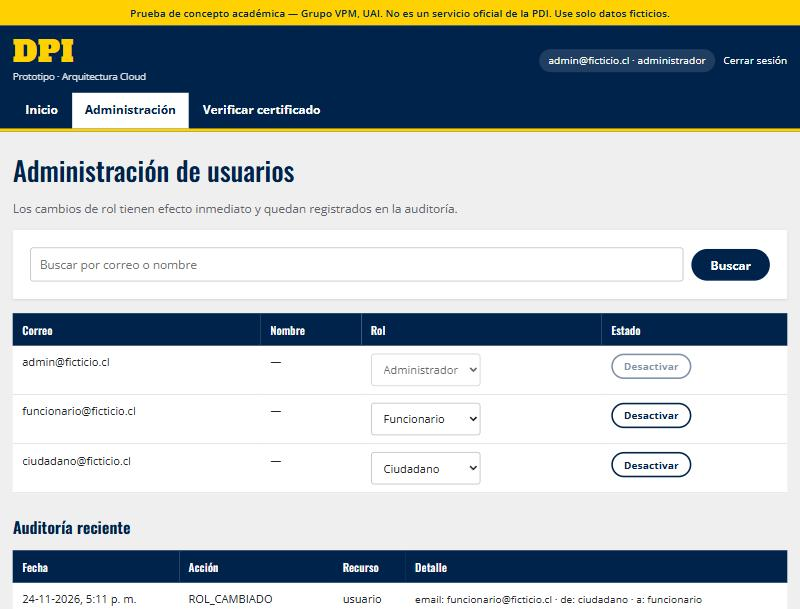 **Administración:** cambio de roles con auditoría. |
| 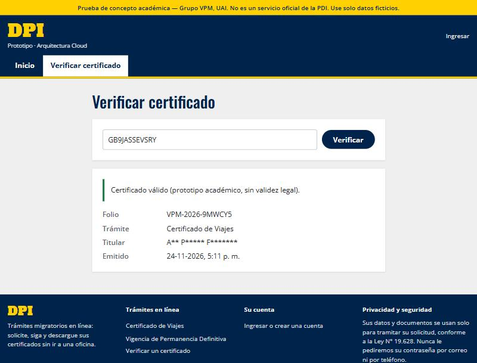 **Verificación pública** del certificado, con el titular enmascarado. | 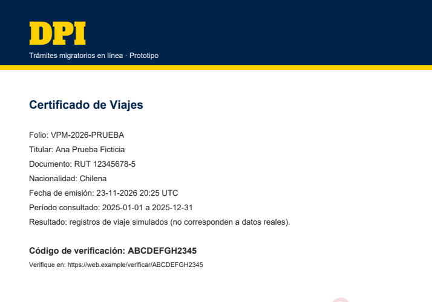 **Certificado PDF** con código de verificación. |

## 8. Pruebas y evidencia

El detalle completo está en [`docs/04-pruebas.md`](04-pruebas.md). En resumen:

| Prueba | Resultado |
|---|---|
| Pruebas automáticas de la API | 47 pasan (SQLite); 42 verificadas también contra PostgreSQL 16 |
| Autenticación real con Identity Platform | Registro, ingreso, roles y revocación de sesiones |
| Documentos en Cloud Storage real | Subida, descarga, no sobrescritura y acceso anónimo bloqueado |
| Flujo de punta a punta en la URL pública | Registro → solicitud → documento → validación → emisión → descarga → verificación |
| Notificaciones | Tres eventos por solicitud registrados en Cloud Logging |
| Lectura con Gemini en GCP | Mismo RUT → OK; RUT distinto → revisión humana sin motivo visible |
| Reproducibilidad | `destroy` completo, recreación y "No changes" |

## 9. Costos

El detalle está en [`docs/05-costos.md`](05-costos.md) (precios de lista en Santiago, consultados en
noviembre de 2026).

| Concepto | Costo estimado |
|---|---|
| Cloud SQL `db-f1-micro` + 10 GB SSD (lo único con costo fijo) | ≈ USD 0,44/día encendido · ≈ USD 2,5/mes pausado |
| Cloud Run, Pub/Sub, Secret Manager, Identity Platform, Cloud Build, Logging | ≈ USD 0 (niveles gratuitos, escala a cero) |
| Gemini | ≈ USD 0,0002 por lectura (medido) |
| **Total de referencia** | **≈ USD 13/mes con todo encendido** |

Controles: alerta de presupuesto de USD 25 (solo notifica), Cloud Run con máximo 2 instancias, Cloud SQL
pausable con una variable de Terraform y ningún recurso con costo fijo fuera de Cloud SQL. El gasto real
acumulado se revisa en la consola (Facturación → Informes).

## 10. Decisiones de diseño

Todas las decisiones están registradas en [`docs/06-decisiones.md`](06-decisiones.md):

| | Decisión |
|---|---|
| D-01 | Un solo ambiente (DEV), parametrizable para QA y PROD |
| D-02 / D-03 | Stack: React, FastAPI, PostgreSQL 16 en Cloud SQL Enterprise `db-f1-micro` |
| D-04 / D-05 | Roles en la base de datos; recursos ajenos responden 404 |
| D-06 | Documentos solo a través de la API |
| D-07 | Validación síncrona con simuladores deterministas, sin Cloud Workflows |
| D-08 / D-09 | Migraciones como Cloud Run Job; eventos sin outbox |
| D-10 | Modo de autenticación de desarrollo bloqueado en la nube |
| D-11 | Proyecto y control de gasto |
| D-12 | Infraestructura destruible y recreable |
| D-13 | Lectura de documentos con Gemini (endpoint global) |
| D-14 | Marca ficticia "DPI" y botón de ClaveÚnica simulado |

## 11. Limitaciones y camino a producción

| Limitación de la prueba de concepto | Qué haría falta en producción |
|---|---|
| Integraciones institucionales simuladas | Convenios y adaptadores reales (ClaveÚnica OIDC, Registro Civil, Migraciones, Interpol) vía VPN HA |
| Sin balanceador ni Cloud Armor: no hay límite de peticiones por IP | Balanceador HTTPS con dominio propio, Cloud Armor y Cloud Run restringido al balanceador |
| Eventos sin outbox: un evento puede perderse si Pub/Sub falla justo después del commit | Patrón outbox o publicación transaccional |
| Cloud SQL sin respaldos ni alta disponibilidad | Respaldos automáticos, recuperación a un punto en el tiempo y edición regional |
| Gemini procesa los documentos fuera de Chile | Evaluación frente a la Ley 19.628 o un modelo disponible en la región |
| Un solo ambiente y despliegue con un script manual | Proyectos DEV/QA/PROD y un pipeline de CI/CD con revisión y pruebas automáticas |
| Sin pruebas automáticas de frontend ni linter | Pruebas de interfaz y análisis estático en el pipeline |
| Notificaciones simuladas en logs | Envío real de correos con un proveedor transaccional |

## 12. Conclusiones

La prueba de concepto demuestra que la arquitectura del Lab 2 es viable en Google Cloud con un costo muy bajo:
menos de medio dólar al día, concentrado en la base de datos. Gracias a Cloud Run, todo lo demás escala a cero.

Implementamos de forma real lo que estaba a nuestro alcance: identidad, API, base de datos privada,
almacenamiento de documentos, bus de eventos, notificaciones y lectura de documentos con IA. Simulamos de forma
explícita, sin fingir que funcionan, las integraciones que dependen de instituciones externas.

La infraestructura como código cumplió su objetivo: la plataforma completa se destruye y se recrea con
Terraform y un script, y la prueba de hacerlo desde cero reveló detalles de GCP que una instalación manual
habría ocultado. Esos detalles quedaron resueltos en el código y documentados para quien replique el proyecto.

---

## Anexo A · Cómo usar la URL de ejemplo

> La URL se apagó el 25-11-2026. Estos pasos sirven igual sobre un despliegue propio o el entorno local.

1. Abrir https://web-636986210007.southamerica-west1.run.app y crear una cuenta con un correo ficticio.
2. Elegir un trámite, completar el formulario con uno de los RUT ficticios de la tabla y adjuntar un PDF, PNG o
   JPG de hasta 5 MB.
3. Para ver el backoffice se usan las cuentas de demostración `funcionario-demo@ficticio.cl` y
   `admin-demo@ficticio.cl`. Su contraseña la entrega el grupo; no se publica en el repositorio.

| RUT ficticio | Resultado de la validación simulada |
|---|---|
| `12345678-5` | Correcta → revisión del funcionario |
| `11222000-3` | Alerta simulada (Interpol) → "En revisión", sin motivo visible |
| `15999999-8` | Identidad no coincide (Registro Civil simulado) → "En revisión" |
| `44555111-2` | Sin registros de viaje → "Observada", pide un respaldo |
| `12345678-0` | RUT inválido → "Observada" |

## Anexo B · Documentación del repositorio

| Documento | Contenido |
|---|---|
| [`README.md`](../README.md) | Estado, estructura y ejecución local |
| [`docs/03-despliegue.md`](03-despliegue.md) | Despliegue en GCP desde cero, paso a paso |
| [`docs/04-pruebas.md`](04-pruebas.md) | Pruebas realizadas y sus resultados |
| [`docs/05-costos.md`](05-costos.md) | Costos y controles de gasto |
| [`docs/06-decisiones.md`](06-decisiones.md) | Registro de decisiones D-01 a D-14 |
